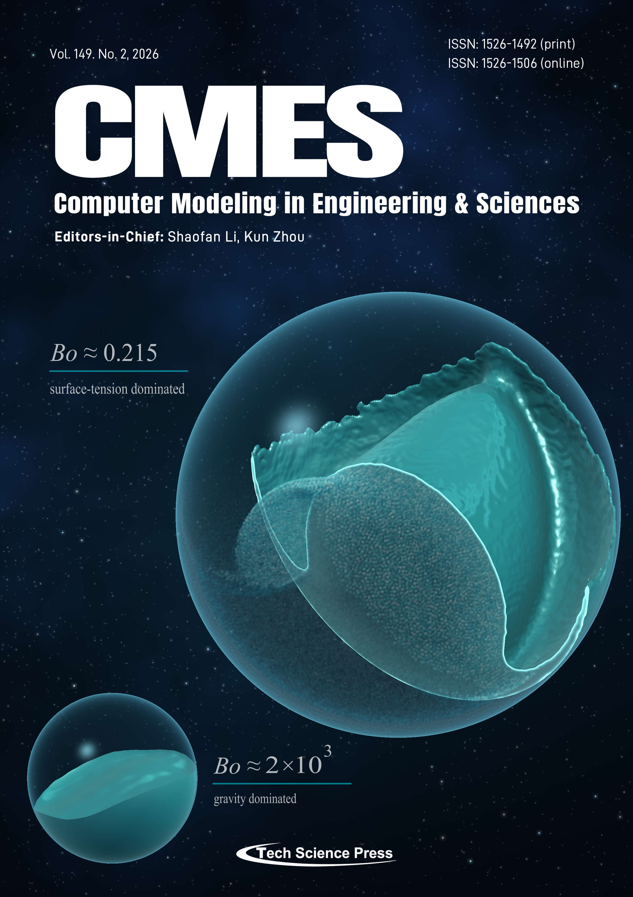

Our recent paper by Jisung Jung and Prof. Hyung-Jun Park, *"SPH Analysis of Bond-Number-Dependent Sloshing Dynamics in a Spherical Tank under Microgravity Conditions,"* has been selected as the Cover Story of *Computer Modeling in Engineering & Sciences* (CMES), Vol. 149, No. 2 (2026).

Using a 3D smoothed particle hydrodynamics (SPH) approach, this study investigates liquid sloshing in spherical propellant tanks under microgravity conditions, highlighting how competing surface tension and gravitational forces (quantified by the Bond number) govern free-surface deformation and liquid redistribution.

- [View Article (CMES Vol. 149, No. 2)](https://www.techscience.com/CMES/v149n2/69840)
- [DOI: 10.32604/cmes.2026.090727](https://doi.org/10.32604/cmes.2026.090727)

